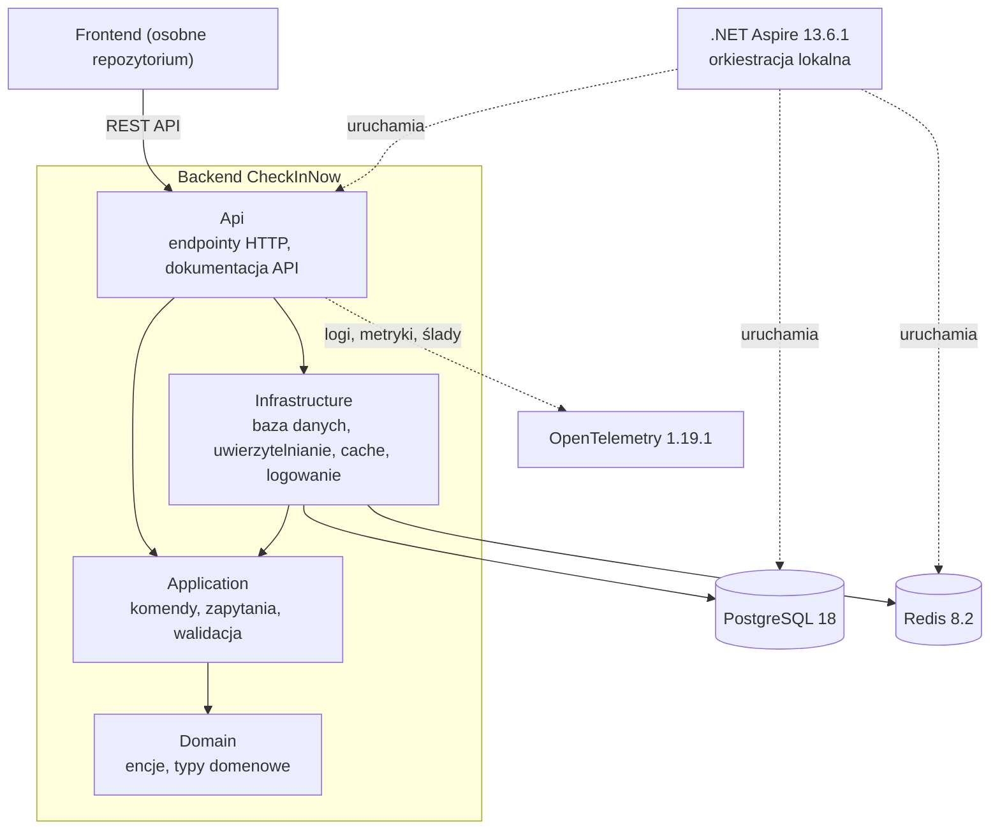

# ADR-001: Architektura backendu

- **Status:** Zaakceptowana
- **Data:** 29.10.2026
- **Autorzy:** Julia Kozłowska, Stanislav Zhuk, Paweł Miedzieński

---

## Kontekst

CheckInNow to system do organizacji konferencji z agendą, zapisami i check-inem QR. Repozytorium zawiera wyłącznie backend, z którym frontend komunikuje się przez REST API.

Aplikacja zawiera wiele reguł biznesowych: wystąpienia nie mogą nakładać się w jednej sali, konferencja ma limit uczestników, a bilet może zostać użyty tylko raz. Wymagana jest architektura, która oddziela te reguły od bazy danych i HTTP, ułatwia ich testowanie i pozwala dodawać nowe funkcje według jednego, powtarzalnego wzorca. Administrator ma również mieć dostęp do logów aplikacji.

---

## Rozważane opcje

### Opcja 1: Clean Architecture (monolit podzielony na warstwy Domain, Application, Infrastructure, Api)
- **Zalety:**
  - logika biznesowa jest niezależna od bazy danych i frameworka webowego,
  - reguły biznesowe można testować bez uruchamiania infrastruktury,
  - jasne zasady umieszczania nowego kodu,
  - jedna aplikacja do wdrożenia.
- **Wady:**
  - więcej projektów i plików niż w prostszych podejściach,
  - przy prostych funkcjach część kodu to powtarzalny szablon.

### Opcja 2: Prosty monolit w jednym projekcie
- **Zalety:**
  - najszybszy start i najmniej kodu,
  - podejście powszechnie znane.
- **Wady:**
  - podział odpowiedzialności opiera się wyłącznie na konwencji,
  - wraz z rozwojem aplikacji logika biznesowa miesza się z dostępem do danych i trudniej ją testować.

### Opcja 3: Mikroserwisy
- **Zalety:**
  - poszczególne części systemu można wdrażać i skalować niezależnie.
- **Wady:**
  - duży narzut infrastrukturalny: komunikacja między serwisami, spójność danych, wiele wdrożeń,
  - trudniejsze testowanie i debugowanie, ponieważ jedno żądanie przechodzi przez kilka serwisów.

## Decyzja

Wybrano **Clean Architecture** na **.NET 10 / C# 14**. Projekt podzielono na warstwy:

- **Domain** – encje i podstawowe typy domenowe,
- **Application** – przypadki użycia (komendy, zapytania, walidacja), pogrupowane według funkcji,
- **Infrastructure** – baza danych, uwierzytelnianie, cache, logowanie,
- **Api** – endpointy HTTP i dokumentacja API.

Zależności są skierowane do środka: Domain nie zależy od żadnej innej warstwy, a Application nie zależy od Infrastructure.

Środowisko lokalne uruchamiane jest przez **.NET Aspire 13.6.1** (API, PostgreSQL i Redis jednym poleceniem) lub przez **Docker Compose**. Logowanie i monitoring zapewniają **Serilog** (`Serilog.AspNetCore` 10.0.0) i **OpenTelemetry 1.19.1** (pakiety instrumentacji w wersji 1.19.0). Aplikacja budowana jest jako obraz **Dockera**, budowanie i testy uruchamia **GitHub Actions**, a środowiskiem docelowym jest **Microsoft Azure** z **Cloudflare** przed aplikacją.

Clean Architecture zapewnia czytelne granice przy dużej liczbie reguł biznesowych, a jednocześnie pozwala zachować jedną aplikację, co odpowiada skali projektu. .NET to technologia, którą zespół backendowy zna najlepiej.

**Konsekwencje:**

- każda nowa funkcja wymaga zmian w kilku warstwach, ale struktura jest przewidywalna i łatwa w przeglądzie,
- logikę biznesową można testować w izolacji,
- zespół musi pilnować reguł zależności między warstwami,
- praca lokalna wymaga Dockera.
